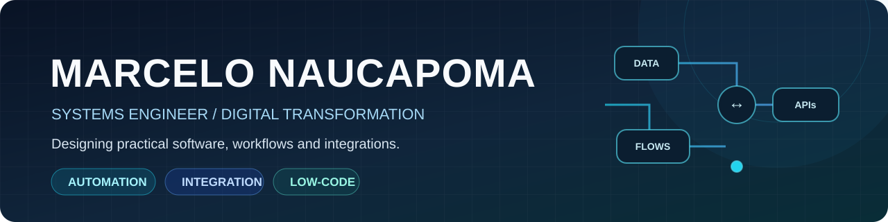

**Systems Engineer · Automation & Integrations · Digital Transformation**

Based in Lima, Peru · Building practical technology for real operational challenges

## Hello, I'm Marcelo 👋

I am a **Systems Engineer** focused on turning fragmented processes and manual tasks into reliable digital workflows. I combine software development, data design, API integrations and low-code/no-code platforms to build solutions that are useful, maintainable and measurable.

I coordinate technical work in a **Center of Excellence (COE)** focused on administrative digital transformation, collaborating with stakeholders to translate operational needs into working applications.

> **My approach:** Understand the process → design the solution → automate and integrate → measure outcomes → improve continuously.

## What I work on

- **Process automation:** workflows, approvals, notifications and operational traceability.
- **Systems integration:** REST APIs, data synchronization and orchestrated services.
- **Internal applications:** low-code platforms and custom web solutions for business teams.
- **Data & engineering:** relational databases, reporting, monitoring and technical documentation.

## Toolbox

| Focus | Tools & technologies |
| :--- | :--- |
| **Languages & backend** | JavaScript, Node.js, Python, C#, SQL |
| **Data** | PostgreSQL, SQL Server, NocoDB |
| **Automation & low-code** | n8n, NocoBase, Kissflow |
| **Infrastructure & delivery** | Docker, AWS, Vercel, Git / GitHub |
| **Engineering practices** | REST APIs, process mapping, technical documentation, KPIs |

*These are technologies I use or have worked with; they are not intended as a proficiency ranking.*

## Selected public projects

### 🌱 [ESP8266 IoT monitoring prototype](https://github.com/MNR05/System-of-monitoring-crops-with-EP8266)
Sensor-data and telemetry prototype using **ESP8266**, Arduino/C++ and Azure IoT Central integration code. Explores temperature, humidity, moisture, light and smoke readings.

### 🧾 [Desktop sales management system](https://github.com/MNR05/Sistema-de-venta-Licoreria)
Academic desktop application built with **C# and SQL Server**, organized into data, business and entity layers. Includes modules for product, user and role management.

### 🌐 [Jutmay multi-page website](https://github.com/MNR05/PW_Jutmay)
Web project with multiple pages and landing pages, using **HTML, CSS and JavaScript**.

### 🎮 [MedievalGame](https://github.com/MNR05/MedievalGame)
**Unity / C#** game project with a medieval setting, NPC-guided missions, collectible coins and enemy avoidance.

[**→ See project notes and repository details**](./docs/PROJECTS.md)

## Current professional interests

- Scalable automation and governance for low-code solutions
- Integration patterns, data quality and system observability
- Applied AI and machine learning for practical engineering problems
- Clear documentation, maintainable systems and measurable improvements

> Some professional projects involve internal systems and are not published here. The repositories above are public examples of my technical work, including academic and experimental projects.

## Let's connect

I enjoy discussing automation, engineering challenges and ways to make technology more useful for teams.

**Email:** [mnr052001@gmail.com](mailto:mnr052001@gmail.com) · **Repositories:** [github.com/MNR05](https://github.com/MNR05)

---

  Built with clarity, curiosity and a focus on real-world impact.

