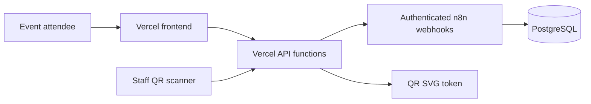

# EventFlow QR

**Event registration & QR check-in with Vercel, n8n and PostgreSQL**


EventFlow QR is an **independently rewritten portfolio starter** for event sign-ups, unique QR tickets and attendance control. It is presented as a general-purpose demonstration using fictional events, without referencing or reproducing any non-public institution or its production infrastructure.

> **Status:** source and importable templates. Configuration and end-to-end testing remain required. No public Vercel deployment or PostgreSQL database has been provisioned by this repository.

## Features

- Responsive sign-up and staff check-in interfaces.
- Server-generated UUID QR tokens, excluding names and email from QR payloads.
- Camera QR scanning where supported and a manual ticket fallback.
- Vercel API functions proxy requests to protected n8n webhooks.
- Two n8n workflows using native **Postgres Execute Query** nodes.
- PostgreSQL database schema with foreign keys, unique indexes and race-safe writes.
- Explicit responses for unknown events, duplicate registrations, repeated check-ins and invalid tickets.
- Configuration through environment variables and n8n's credential manager, without publishing secrets.

## Architecture



**Responsibility split:** Vercel serves the interface and API, n8n orchestrates the workflows, and PostgreSQL stores events, registrations and attendance. The database is **not** connected directly to the visitor's browser.

## Project structure

```text
projects/eventflow-qr/
├── api/                 # Vercel registration, check-in and QR endpoints
├── db/
│   ├── schema.sql       # PostgreSQL tables and constraints
│   ├── seed.demo.sql    # Fictional DEMO-2026 event
│   └── smoke-checks.sql # Safe schema inspection queries
├── n8n/
│   ├── register.json    # Registration to PostgreSQL
│   └── checkin.json     # Check-in to PostgreSQL
├── docs/
│   └── SETUP.md         # Installation, architecture and tests
├── index.html           # Registration and staff UI
├── app.js               # Client interaction, camera and QR
├── styles.css
├── package.json
└── .env.example
```

## Quick start

1. Create an isolated PostgreSQL database and run [`db/schema.sql`](./db/schema.sql), then [`db/seed.demo.sql`](./db/seed.demo.sql).
2. Import both workflow JSON files into your own n8n instance. Attach a **least-privileged Postgres credential** to both database nodes.
3. Attach **Header Auth credentials** to each n8n webhook using your own `x-eventflow-secret`.
4. Set Vercel's project **Root Directory** to `projects/eventflow-qr`. Install dependencies with `npm install` and run `npx vercel dev`.
5. Configure all four server variables from [`.env.example`](./.env.example).
6. Test registration, QR validation and duplicates with fictional attendee data before activating webhooks.

See [**complete setup, SQL model and security checks**](./docs/SETUP.md).

## Example API

`POST /api/register`

```json
{"eventId":"DEMO-2026","name":"Alex Rivera","email":"alex@example.org","consent":true}
```

After a successful DB insert, the API responds with `{"ok":true,"ticket":"<random UUID>"}`.

`POST /api/checkin` with the required staff token in the `x-staff-key` header:

```json
{"eventId":"DEMO-2026","ticket":"<UUID from registration>"}
```

Successful response: `{"ok":true,"status":"checked_in"}`. A duplicate check-in returns 409, and a ticket unknown to the event returns 404.

## Data integrity and security

- **Duplicate registration:** PostgreSQL unique index on event and normalized email.
- **Repeated check-in:** composite primary key on event and QR token.
- **Invalid ticket:** foreign key to the registration for the same event.
- **SQL injection:** parameterized PostgreSQL queries using `$1::jsonb`.
- **Secrets:** only in server-side configuration and n8n credentials; never in GitHub.
- **Privacy:** QR tokens contain no personal details; demo data is fictional.

This portfolio implementation is not a substitute for a full production security review or data protection measures. A staff shared secret is intended only for the demonstration; production needs role-based authentication, abuse protection and auditing.

**License:** No license has been granted for reuse beyond applicable law.
