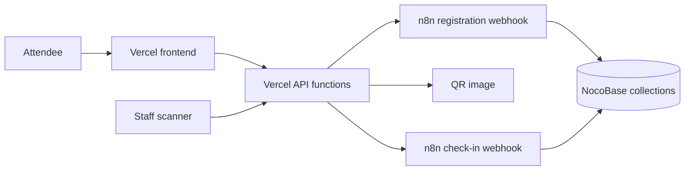

# EventFlow QR
### Generic event registration and QR check-in starter

**Stack:** n8n · Vercel Functions · NocoBase REST API · JavaScript · QR codes

EventFlow QR is a **public, independently rewritten portfolio starter** inspired by experience building event registration and attendance automation. It is **not a copy of any private production system**, does not include third-party data and is not presented as an audited production deployment.

> **Status: demo/source template.** The frontend and serverless endpoints are provided as source; n8n workflows and NocoBase collections still require configuration and an end-to-end test before live use.

## Features

- Event sign-up using a compact form and explicit consent.
- Unique random ticket identifier generated server-side.
- QR image generated from the ticket token only (no name, email or ID inside QR).
- Operator check-in with a protected API proxy, camera scanning when supported, and manual entry fallback.
- Registration and attendance flows orchestrated in n8n.
- Data persisted through the NocoBase REST API.
- Modular structure and secrets kept outside the repository.

## Architecture



Vercel handles public web requests, minimal input validation, QR rendering and the staff authorization check. n8n handles orchestration and NocoBase access. The NocoBase API key is held in n8n credentials, **never** sent to the browser or committed to GitHub.

## Project files

| Path | Purpose |
| --- | --- |
| [index.html](./index.html) | Registration and check-in user interface |
| [app.js](./app.js) | Frontend interactions and camera QR detection |
| [styles.css](./styles.css) | Responsive visual design |
| [api/register.js](./api/register.js) | Vercel registration proxy |
| [api/checkin.js](./api/checkin.js) | Staff-gated Vercel check-in proxy |
| [api/qr.js](./api/qr.js) | On-demand server-side QR SVG rendering |
| [n8n/register.json](./n8n/register.json) | Registration workflow template |
| [n8n/checkin.json](./n8n/checkin.json) | Check-in workflow template |
| [docs/SETUP.md](./docs/SETUP.md) | Database model, setup and limitations |

## Running the frontend

1. Copy this folder into its **own Git repository** or set it as the **Vercel Root Directory**. This repository also acts as the author's GitHub profile, so the project is under `projects/eventflow-qr/`.
2. Install Node.js dependencies with `npm install` and run `npx vercel dev` (Vercel CLI required).
3. Configure server-only variables using [`.env.example`](./.env.example). Never commit `.env` or `.env.local`.
4. Create NocoBase collections and import the n8n workflows following [setup instructions](./docs/SETUP.md).
5. Configure real webhook URLs and the staff key before enabling the check-in workflow.

The UI expects a demo event such as `DEMO-2026`; this is a **fictional placeholder**. No real attendee records are supplied.

## Request/response contract

Registration: `POST /api/register`

```json
{"eventId":"DEMO-2026","name":"Alex Rivera","email":"alex@example.org","consent":true}
```

Returns `{"ok":true,"ticket":"<random UUID>"}` after successful persistence.

Check-in: `POST /api/checkin` with `x-staff-key` header

```json
{"eventId":"DEMO-2026","ticket":"<ticket UUID>"}
```

Expected workflow response: `{"ok":true,"status":"checked_in"}`. Invalid/duplicate tickets require explicit error handling and database uniqueness controls before production use.

## Security and publication boundaries

- No private workflow exports, tenant identifiers, participant records, internal addresses or credentials.
- No sensitive identity data in QR payloads: the QR contains a random ticket token.
- Server-side API keys and staff keys only in environment variables / n8n credentials.
- Staff check-in uses a shared secret for this demo. Use proper identity, roles, rate limits and auditing in production.
- Add uniqueness constraints for registrations and check-ins to prevent concurrency-related duplicates.
- Do not use with personal data until privacy, retention, consent and deletion policies are reviewed.

**License:** No license is included at this stage; all rights reserved until an explicit license is selected.
