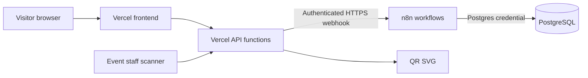

# EventFlow QR — PostgreSQL setup and security

> **Status:** independently rewritten portfolio starter. No institutional code, data, domains or credentials. The new PostgreSQL workflows have not been end-to-end tested against a configured live instance.

## Architecture

The browser never accesses PostgreSQL. Vercel handles client-facing endpoints, QR encoding and a simple demonstration staff secret. n8n uses **Postgres Execute Query** nodes with a dedicated database credential. Registration and check-in are backed by database constraints, not race-prone read-then-write logic.

## Database

1. Create a separate PostgreSQL database in your own environment, for example `eventflow_demo`. Do not use an internal or shared production database.
2. Execute [`../db/schema.sql`](../db/schema.sql) using a privileged **setup-only** account. It creates:
   - `eventflow.events`: demo event with `registration_open`.
   - `eventflow.registrations`: attendee records with random UUID QR tokens and a unique event/email index.
   - `eventflow.checkins`: one attendance record per event/token, with a composite FK to a registration.
3. Execute [`../db/seed.demo.sql`](../db/seed.demo.sql) to add fictional event `DEMO-2026`.
4. Review [`../db/smoke-checks.sql`](../db/smoke-checks.sql) to verify basic schema objects.
5. Provision a dedicated, least-privileged database user for n8n. Grant `USAGE` on the `eventflow` schema; `SELECT` on `events`; `SELECT, INSERT` on `registrations` and `checkins`; and required usage on the registration identity sequence. Do not use your PostgreSQL admin login for the workflow.

The schema enforces registration uniqueness using `(event_id, lower(btrim(email)))` and prevents check-in duplication through primary key `(event_id, qr_token)`. Foreign keys ensure that an attendance ticket belongs to the specified event. A second registration attempt is rejected as a conflict even under concurrent submissions.

## n8n

1. Import `../n8n/register.json` and `../n8n/checkin.json`.
2. Configure a **Postgres** credential for your test database (host, port, database, username, password, SSL when required). Attach it to **both PostgreSQL nodes** after import. **No credentials** are included in public workflow JSON.
3. For each Webhook node, attach an **Header Auth** credential with header name `x-eventflow-secret` and an independently generated strong value.
4. Set the same value in Vercel as `N8N_WEBHOOK_SHARED_KEY`; do not paste it in source files.
5. Test the database nodes in a sandbox and verify `$1::jsonb` parameter binding with your n8n version. The supplied nodes use `options.queryReplacement` for the **single parameter** and do not concatenate browser values into SQL.
6. Configure production webhook URLs in Vercel. Activate only after local checks and permission review.

### Registration

`POST /api/register` → authenticated n8n webhook → atomic PostgreSQL `INSERT ... SELECT ... ON CONFLICT DO NOTHING` → response.

Possible workflow results: `registered` (201), `duplicate_or_invalid` (409), `unknown_event` (404), `event_closed` (400). The frontend sends `eventId`, `name`, `email` and `consent`. Vercel generates a random UUID server-side and passes it to n8n. The QR contains **only** the UUID.

### Check-in

`POST /api/checkin` → staff-secret validation in Vercel → authenticated n8n webhook → atomic PostgreSQL insert from the matching registration → response.

Possible results: `checked_in` (200), `already_checked_in` (409), `invalid_ticket` (404).

PostgreSQL handles the duplicate condition atomically; the application never relies only on checking a row before creating it.

## Vercel

Deploy `projects/eventflow-qr` as the Vercel project's **Root Directory**, not the full profile repository. Install dependencies using `npm install` and preview locally using `npx vercel dev`.

Server-only variables (see [`.env.example`](../.env.example)):

| Name | Purpose |
| --- | --- |
| `N8N_REGISTER_WEBHOOK_URL` | n8n HTTPS registration webhook |
| `N8N_CHECKIN_WEBHOOK_URL` | n8n HTTPS check-in webhook |
| `N8N_WEBHOOK_SHARED_KEY` | Shared Vercel → n8n Header Auth secret |
| `CHECKIN_ADMIN_TOKEN` | Separate demo secret for event staff |

**Do not put PostgreSQL host, user or password in Vercel or frontend JavaScript.** PostgreSQL connectivity belongs exclusively in the n8n credential manager.

## Verification checklist

- [ ] Apply schema and fictional seed to an isolated PostgreSQL database.
- [ ] Check registration works for `DEMO-2026` and returns a UUID.
- [ ] Check repeated email for same event returns 409, including under parallel requests.
- [ ] Check unknown and closed events are rejected.
- [ ] Verify QR codes contain only a UUID, not personal information.
- [ ] Confirm matching QR scans correctly; test manual fallback.
- [ ] Confirm wrong event/token results in 404.
- [ ] Check repeated and simultaneous check-ins return a single stored attendance row.
- [ ] Confirm direct n8n webhook calls without Header Auth are denied.
- [ ] Confirm PostgreSQL credentials and secrets are absent from browser assets, API errors and GitHub.
- [ ] Add authentication/authorization, rate limiting, CAPTCHA, privacy and deletion policy, monitoring and HTTPS/TLS before handling real participants.

## Scope and limitations

This is a code and architecture demonstration. It has **not** been connected to a public PostgreSQL instance or deployed to Vercel as part of this refactor. It is not ready to collect actual participant information or claim production uptime/security. All test examples are fictional.
